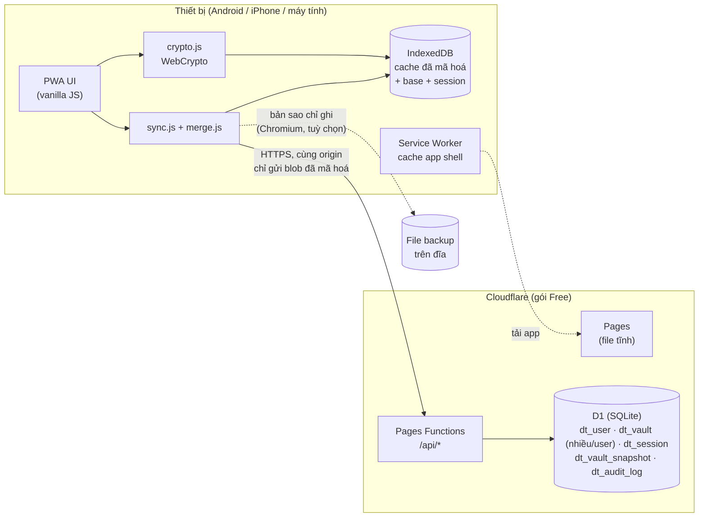

# 02 · Kiến trúc

## Sơ đồ tổng thể



Nguyên tắc: **mọi thao tác mã hoá và giải mã đều diễn ra trên thiết bị.** Server chỉ nhận và trả blob, kiểm tra phiên đăng nhập và kiểm tra version.

## Thành phần

| Thành phần | Trách nhiệm |
|---|---|
| **PWA UI** | Màn hình đăng nhập/mở khoá, điều hướng project/env, danh sách, chi tiết, sửa, cài đặt. Bố cục 3 cột trên desktop, xếp chồng trên mobile |
| **crypto.js** | PBKDF2, HKDF, AES-GCM, bọc/mở `accountKey` và `vaultKey`, WebAuthn PRF |
| **store.js** | Đọc và ghi IndexedDB: blob cục bộ và base **theo từng vault**, session token, `accountKey` đã bọc bằng passkey, cài đặt riêng từng thiết bị |
| **merge.js** | Hàm thuần `merge(base, local, remote) → {result, conflicts}`, gộp **theo thuộc tính và theo field**, có unit test |
| **sync.js** | Pull/push với server cho từng vault, gom các thay đổi (debounce), thử lại khi mất mạng, hiển thị trạng thái đồng bộ |
| **mirror.js** | Bản sao tự động chỉ ghi ra file qua File System Access API (chỉ Chromium); không bao giờ đọc file để sync |
| **config.js** | Cấu hình theo domain (xem [Cấu hình theo domain](#cấu-hình-theo-domain)) |
| **Service Worker** | Cache app shell theo version để mở được khi offline; **không** cache `/api/*` |
| **Pages Functions** | API REST trong [06-api.md](06-api.md): auth, vault, sessions, snapshots |
| **D1** | Lưu user, blob, session, snapshot, audit. Xem [03-data-model.md](03-data-model.md) |

## Luồng chính

### Lần đầu trên một thiết bị mới

```mermaid
sequenceDiagram
  participant U as Người dùng
  participant C as Client
  participant S as Server
  U->>C: username + master password
  C->>S: GET /api/prelogin?username
  S-->>C: kdf {iter, salt}
  C->>C: masterKey = PBKDF2(pw, salt, iter)<br/>encKey, authKey = HKDF(masterKey)
  C->>S: POST /api/login {username, authKey, device}
  S-->>C: session token + wrappedAccountKey
  C->>C: accountKey = unwrap(encKey, wrappedAccountKey)
  C->>S: GET /api/vaults
  S-->>C: [{id, version, wrappedVaultKey, meta}]
  loop mỗi vault
    C->>S: GET /api/vaults/:id
    S-->>C: {version, blob}
    C->>C: vaultKey = unwrap(accountKey, wrappedVaultKey)<br/>giải mã → vault; lưu blob + base vào IndexedDB
  end
  C-->>U: (tuỳ chọn) đăng ký passkey để lần sau mở bằng vân tay
```

### Mở khoá hằng ngày

1. App mở từ cache của Service Worker, nên có mạng hay không đều được.
2. Mở khoá bằng passkey (vân tay/Face ID) hoặc master password. Bước này hoàn toàn cục bộ, **không cần mạng**.
3. Nếu có mạng, chạy đồng bộ ở nền ([05-sync.md](05-sync.md)).

### Khi sửa một item

1. Sửa vault trong bộ nhớ, cập nhật đồng hồ (`clock`) của **đúng các thuộc tính và field vừa đổi**, cập nhật `updatedAt`, đẩy phiên bản cũ vào `history`.
2. Mã hoá lại vault đó rồi ghi vào IndexedDB ngay, đánh dấu `dirty`.
3. Sau khoảng 1–2 giây debounce, `sync.js` push vault đó lên. Nếu bị 409, nó pull về, gộp, rồi push lại.
4. Nếu đã bật bản sao file, `mirror.js` ghi lại file sau khoảng 10 giây debounce.

## Công nghệ

| Lớp | Lựa chọn |
|---|---|
| Frontend | HTML, CSS, JavaScript ES modules, không framework, không build |
| Mã hoá | WebCrypto (PBKDF2-SHA256, HKDF-SHA256, AES-GCM-256), WebAuthn PRF |
| Lưu trữ cục bộ | IndexedDB |
| Offline | Service Worker cùng Web App Manifest |
| Backend | Cloudflare Pages Functions (Workers runtime) |
| Database | Cloudflare D1 |
| Triển khai | `wrangler` CLI; repo git cá nhân (có thể dùng Pages tự deploy từ GitHub) |
| Test | `node --test` cho `merge.js` và `crypto.js`; Playwright (tuỳ chọn) cho E2E |

## Cấu trúc repo đề xuất

```
keymesh/
├── README.md
├── docs/                      # tài liệu này
├── legacy/
│   └── envvault.html          # bản v1 một file, chạy cục bộ (giữ để tham chiếu và migrate)
├── public/                    # Cloudflare Pages phục vụ thư mục này
│   ├── index.html
│   ├── manifest.webmanifest
│   ├── sw.js
│   ├── icons/
│   └── js/
│       ├── app.js             # khởi động, router, render
│       ├── ui/                # các màn hình
│       ├── crypto.js
│       ├── store.js
│       ├── sync.js
│       ├── merge.js
│       ├── mirror.js          # bản sao tự động ra file (Chromium)
│       ├── config.js          # cấu hình theo domain
│       └── model.js           # schema, migrate v1 → v2, validate
├── functions/
│   └── api/
│       └── [[route]].js       # router API (hoặc tách file theo nhóm)
├── migrations/
│   └── 0001_init.sql
├── test/
│   ├── merge.test.js
│   └── crypto.test.js
├── _headers                   # CSP và các security header cho Pages
└── wrangler.toml
```

## Triển khai và vận hành

- **Môi trường:** chỉ có `prod`, cùng một project `preview` của Pages để thử với một D1 riêng.
- **Domain:** dùng `*.pages.dev` trước. Code không hard-code domain nào, để có thể chuyển sang domain riêng bằng cách đổi cấu hình (xem bên dưới). Khi có domain riêng, có thể đặt thêm **Cloudflare Access** (Zero Trust free) phía trước để có thêm một lớp đăng nhập. Xem [04-security.md](04-security.md).
- **Backup:** server giữ 30 snapshot gần nhất cho mỗi vault. Người dùng có thể tải **bản backup đã mã hoá** về bất cứ lúc nào, và trên Chromium có thể bật **bản sao tự động ra file**.

### Cấu hình theo domain

| Ở đâu | Giá trị | Ghi chú |
|---|---|---|
| Server (`wrangler.toml` / biến môi trường Pages) | `ALLOWED_ORIGINS` | Danh sách origin được phép gọi API, ví dụ `https://keymesh.pages.dev,https://vault.example.com`. Server kiểm tra header `Origin` |
| Server | `RP_ID` | Không dùng ở giai đoạn này (passkey chỉ mở khoá cục bộ), để sẵn cho khi passkey dùng để đăng nhập server |
| Client (`config.js`) | Origin và RP ID của WebAuthn | Lấy từ `location.origin` và `location.hostname` lúc chạy, không hard-code |
| `_headers` | CSP | Chỉ dùng `'self'`, nên không phụ thuộc domain |

Khi chuyển từ `pages.dev` sang domain riêng:

- **IndexedDB gắn theo origin**: trên domain mới, mỗi thiết bị phải đăng nhập lại và tải vault từ server. Trước khi chuyển, đảm bảo mọi thiết bị đã sync xong (không còn thay đổi dirty) ở domain cũ.
- **Passkey gắn theo RP ID** (domain): phải đăng ký lại passkey trên domain mới.
- Giữ domain cũ trong `ALLOWED_ORIGINS` một thời gian để thiết bị nào còn thay đổi chưa push vẫn push được.
- File bản sao tự động phải chọn lại trên domain mới.
- **Giới hạn gói Free:** 100k request/ngày cho Workers, D1 5 GB và 5 triệu lượt đọc/ngày. Mức dùng cá nhân thấp hơn hàng nghìn lần.
