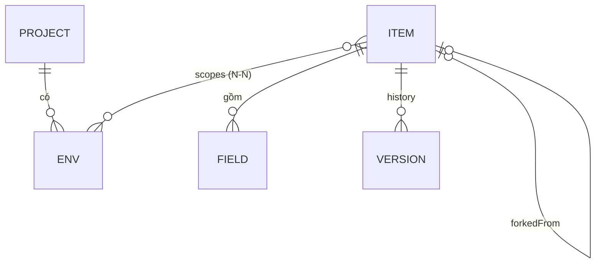

# 03 · Thiết kế dữ liệu

Dữ liệu nằm ở ba tầng:

1. **Vault (plaintext)**: JSON chỉ tồn tại trong bộ nhớ của client sau khi giải mã.
2. **Envelope (ciphertext)**: vault sau khi mã hoá, được lưu ở IndexedDB và trên server.
3. **D1 schema**: những gì server biết, gồm metadata, blob, session và audit.

---

## 1. Vault v2 (plaintext, chỉ ở client)

### Mô hình khái niệm



- Một item có thể nằm trong nhiều env, **kể cả env thuộc các project khác nhau**.
- Item có `scopes = []` là item "chưa gán", vẫn hợp lệ và hiện trong mục *Chưa gán*.

### So với v1

| v1 (hiện tại, `legacy/envvault.html`) | v2 |
|---|---|
| `envs` lồng trong `project.envs[]` | Tách ra thành mảng phẳng `envs[]` với `projectId`, để gộp từng env độc lập |
| Xoá là xoá hẳn | Dùng tombstone `deletedAt` cho mọi thực thể |
| Project/env không có `updatedAt` | Mọi thực thể đều có `createdAt`, `updatedAt` và `rev` |
| Khoá mã hoá dẫn xuất trực tiếp từ mật khẩu | Dùng `vaultKey` ngẫu nhiên, được bọc lại (xem mục 2) |
| Không có thứ tự tuỳ chỉnh | Có `order` cho project và env |

### Schema

```jsonc
{
  "v": 2,
  "projects": [
    {
      "id": "p_8f3a…",          // 16 hex ngẫu nhiên, tiền tố theo loại
      "name": "Payment Gateway",
      "order": 0,
      "createdAt": 1761600000000,
      "updatedAt": 1761600000000,
      "rev": 1,                   // tăng mỗi lần sửa, dùng để phát hiện xung đột
      "deletedAt": null           // tombstone
    }
  ],
  "envs": [
    {
      "id": "e_19c2…",
      "projectId": "p_8f3a…",
      "name": "uat",
      "order": 1,
      "color": null,              // tuỳ chọn, ví dụ "red" cho prod để dễ nhận ra
      "createdAt": 0, "updatedAt": 0, "rev": 1, "deletedAt": null
    }
  ],
  "items": [
    {
      "id": "i_77ab…",
      "type": "login",            // login | api_key | token | ssh | doc | note
      "title": "Partner X portal",
      "fields": [
        { "id": "f_01", "label": "Username", "kind": "text",   "v": "acme_uat" },
        { "id": "f_02", "label": "Password", "kind": "secret", "v": "••••" },
        { "id": "f_03", "label": "URL",      "kind": "url",    "v": "https://…" }
      ],
      "notes": "Đối tác cấp, dùng chung UAT + Staging",
      "tags": ["partner-x"],
      "favorite": false,
      "expires": "2026-12-31",    // ISO date hoặc null, dùng để nhắc sắp hết hạn
      "scopes": ["e_19c2…", "e_5d10…"],
      "forkedFrom": null,         // id item gốc nếu là bản fork
      "history": [                // tối đa HISTORY_MAX = 20, mới nhất ở đầu
        {
          "at": 1761500000000,
          "rev": 3,
          "reason": "edit",       // edit | conflict | restore
          "title": "…", "type": "…", "fields": [], "notes": "…", "expires": null, "scopes": []
        }
      ],
      "createdAt": 0, "updatedAt": 0, "rev": 4, "deletedAt": null
    }
  ]
}
```

### Kiểu field (`kind`)

| kind | Hiển thị | Copy | Ẩn mặc định |
|---|---|---|---|
| `text` | 1 dòng | ✓ | |
| `secret` | 1 dòng | ✓ | ✓ |
| `url` | link mở được | ✓ | |
| `multi` | nhiều dòng | ✓ | |
| `secret-multi` | nhiều dòng | ✓ | ✓ |

### Mẫu field theo loại item (giữ như v1)

| type | Field mặc định |
|---|---|
| `login` | Username (text), Password (secret), URL (url) |
| `api_key` | API key (secret), Secret (secret), Endpoint (url) |
| `token` | Token (secret-multi) |
| `ssh` | Private key (secret-multi), Public key (multi), Passphrase (secret) |
| `doc` | URL (url) |
| `note` | — (dùng `notes`) |

### Quy tắc toàn vẹn

- **Xoá env:** đặt `deletedAt` cho env đó. Các item vẫn **giữ** `envId` trong `scopes`, nhưng UI bỏ qua env đã xoá. Nhờ vậy, nếu thiết bị khác vẫn đang sửa item thì khi gộp không bị lỗi tham chiếu. Item không còn env sống nào thì hiện ở *Chưa gán*.
- **Xoá project:** đặt tombstone cho project và mọi env của nó. Item xử lý như khi xoá env.
- **Xoá item:** đặt `deletedAt` và **xoá trắng `fields`, `notes`, `history`** để không giữ secret của item đã xoá. Thùng rác (giữ lại để khôi phục) là tính năng tuỳ chọn, xem [07-features.md](07-features.md).
- **Thay đổi đáng lưu lịch sử:** title, type, fields, notes, expires, scopes. Không tính `favorite` hay `order`.
- `rev` tăng 1 mỗi lần lưu. `updatedAt` lấy theo giờ của thiết bị, chỉ dùng để phân xử khi cả hai bên cùng sửa.

### Cài đặt riêng từng thiết bị (không nằm trong vault)

Lưu ở IndexedDB, không đồng bộ: thời gian tự khoá, thời gian xoá clipboard, giao diện sáng/tối, project/env đang chọn, có bật passkey hay không.

---

## 2. Khoá và envelope

### Cấu trúc khoá

```
master password
   │ PBKDF2-SHA256 (iter = 600 000, salt 16B)
   ▼
masterKey (32B)
   ├─ HKDF-SHA256(info="keymesh/enc")  ─▶ encKey  ─┐ bọc (AES-GCM)
   └─ HKDF-SHA256(info="keymesh/auth") ─▶ authKey  │
                                                     ▼
                     vaultKey (32B ngẫu nhiên, sinh một lần khi tạo vault)
                                                     ▲
passkey ─ WebAuthn PRF(salt) ─ HKDF(info="keymesh/prf") ─▶ prfKey ─┘ bọc (chỉ lưu ở thiết bị)
```

### Envelope cho vault

```jsonc
{
  "format": "keymesh",
  "v": 2,
  "alg": "AES-GCM-256",
  "iv": "<base64 12B>",
  "ct": "<base64>"         // AES-GCM(vaultKey, iv, gzip(JSON(vault)), aad = "keymesh/v2/vault/<userId>")
}
```

- Nén bằng `CompressionStream('gzip')` trước khi mã hoá để giảm kích thước.
- AAD gắn userId, nên blob của user này không giải mã được dưới user khác.
- Mỗi lần lưu dùng **IV ngẫu nhiên mới**.

### Envelope cho `vaultKey` đã bọc

```jsonc
{ "iv": "<base64 12B>", "ct": "<base64 48B>" }   // AES-GCM(encKey | prfKey, vaultKey, aad="keymesh/v2/key")
```

### File backup để tải về (export đã mã hoá)

Tự chứa đủ để mở lại mà không cần server:

```jsonc
{
  "format": "keymesh-backup", "v": 2,
  "kdf": { "name": "PBKDF2-SHA256", "iter": 600000, "salt": "<b64>" },
  "wrappedVaultKey": { "iv": "…", "ct": "…" },
  "vault": { "iv": "…", "ct": "…" },
  "exportedAt": 1761600000000
}
```

---

## 3. Lưu trữ cục bộ (IndexedDB `keymesh`, version 1)

| Object store | Key | Value |
|---|---|---|
| `meta` | `account` | `{ userId, username, kdf, wrappedVaultKey, deviceId }` |
| `meta` | `session` | `{ token, expiresAt }`. Token là bearer token để gọi API; nằm ở IndexedDB nên chỉ đọc được từ cùng origin |
| `meta` | `passkey` | `{ credentialId, prfSalt, wrappedVaultKey }` (bọc bằng prfKey) |
| `meta` | `settings` | cài đặt riêng của thiết bị |
| `vault` | `current` | `{ envelope, version, dirty, savedAt }`: trạng thái cục bộ mới nhất, có thể chưa push |
| `vault` | `base` | `{ envelope, version }`: bản server ở lần đồng bộ thành công gần nhất |

Không lưu plaintext hay `vaultKey` dạng chưa bọc xuống đĩa trong bất kỳ trường hợp nào.

---

## 4. D1 schema (server)

```sql
-- migrations/0001_init.sql

CREATE TABLE users (
  id                 TEXT PRIMARY KEY,          -- 'u_' + 16 hex
  username           TEXT NOT NULL UNIQUE COLLATE NOCASE,
  kdf_name           TEXT NOT NULL DEFAULT 'PBKDF2-SHA256',
  kdf_iter           INTEGER NOT NULL,
  kdf_salt           TEXT NOT NULL,             -- base64
  auth_hash          TEXT NOT NULL,             -- base64(SHA-256(authKey))
  wrapped_vault_key  TEXT NOT NULL,             -- JSON {iv, ct}, bọc bằng encKey
  security_stamp     TEXT NOT NULL,             -- đổi khi đổi mật khẩu để vô hiệu hoá mọi session
  created_at         INTEGER NOT NULL,
  updated_at         INTEGER NOT NULL
);

CREATE TABLE vaults (
  user_id            TEXT PRIMARY KEY REFERENCES users(id) ON DELETE CASCADE,
  version            INTEGER NOT NULL,          -- tăng 1 mỗi lần PUT thành công
  blob               TEXT NOT NULL,             -- JSON envelope
  size               INTEGER NOT NULL,
  updated_at         INTEGER NOT NULL,
  updated_by_session TEXT
);

CREATE TABLE vault_snapshots (                  -- giữ N bản gần nhất để khôi phục khi lỡ tay
  user_id            TEXT NOT NULL REFERENCES users(id) ON DELETE CASCADE,
  version            INTEGER NOT NULL,
  blob               TEXT NOT NULL,
  created_at         INTEGER NOT NULL,
  PRIMARY KEY (user_id, version)
);

CREATE TABLE sessions (
  id                 TEXT PRIMARY KEY,          -- 's_' + 16 hex, hiện trong danh sách thiết bị
  user_id            TEXT NOT NULL REFERENCES users(id) ON DELETE CASCADE,
  token_hash         TEXT NOT NULL UNIQUE,      -- SHA-256(token); token gốc chỉ client giữ
  security_stamp     TEXT NOT NULL,             -- phải khớp users.security_stamp
  device_name        TEXT,                      -- "Pixel 8 · Chrome"
  created_at         INTEGER NOT NULL,
  last_seen_at       INTEGER NOT NULL,
  expires_at         INTEGER NOT NULL           -- trượt: gia hạn 30 ngày mỗi lần dùng
);
CREATE INDEX idx_sessions_user ON sessions(user_id);

CREATE TABLE auth_attempts (                    -- rate limit đăng nhập
  key                TEXT PRIMARY KEY,          -- 'u:<username>' hoặc 'ip:<hash ip>'
  count              INTEGER NOT NULL,
  window_start       INTEGER NOT NULL,
  locked_until       INTEGER
);

CREATE TABLE audit_log (
  id                 INTEGER PRIMARY KEY AUTOINCREMENT,
  user_id            TEXT,
  session_id         TEXT,
  at                 INTEGER NOT NULL,
  action             TEXT NOT NULL,             -- login | login_fail | logout | vault_put | vault_conflict
                                                -- | password_change | session_revoke | snapshot_restore
  meta               TEXT                       -- JSON nhỏ, KHÔNG chứa dữ liệu vault
);
CREATE INDEX idx_audit_user_at ON audit_log(user_id, at DESC);
```

### Ghi chú

- **Giới hạn D1:** một dòng hoặc giá trị tối đa khoảng 2 MB. Vault cá nhân sau khi nén và mã hoá thường dưới 200 KB. Client cảnh báo khi blob vượt 1 MB; nếu thật sự cần thì chia blob thành nhiều chunk.
- **Số snapshot:** giữ 30 bản gần nhất. Khi PUT, chép bản cũ sang `vault_snapshots` rồi xoá bớt bản cũ trong cùng một `batch()`.
- **Những gì server biết:** username, thời điểm sửa, kích thước blob, thiết bị, IP (dạng hash, dùng cho rate limit). Server **không** biết tên project, env, item hay số lượng item.
- **Multi-user sau này:** bảng `users` đã tách riêng, nên muốn chia sẻ chỉ cần thêm `orgs`, `members`, `env_keys`. Xem [08-roadmap.md](08-roadmap.md).

---

## 5. Migrate v1 → v2

Có hai đường vào:

1. **Import file `envvault.json` v1** (`"format": "envvault"`, tên cũ của dự án): nhập mật khẩu cũ để giải mã.
2. **Import từ localStorage** (`envvault`), nếu chạy cùng origin với bản v1. Trường hợp này hiếm, vì v1 chạy dưới `file://` hoặc localhost.

Các bước chuyển đổi trong `model.js`:

```text
for project in v1.projects:
    for (i, env) in project.envs:  envs.push({...env, projectId: project.id, order: i, rev: 1, …timestamps})
    project = {id, name, order, rev: 1, …timestamps}
for item in v1.items:
    item.rev = history.length + 1; item.deletedAt = null; item.tags = []; item.favorite = false
    history[*].rev, reason = 'edit'
sinh vaultKey mới → mã hoá theo envelope v2 → PUT lên server (version 0 → 1)
```

Sau khi migrate, giữ nguyên file v1 và để người dùng tự xoá.
