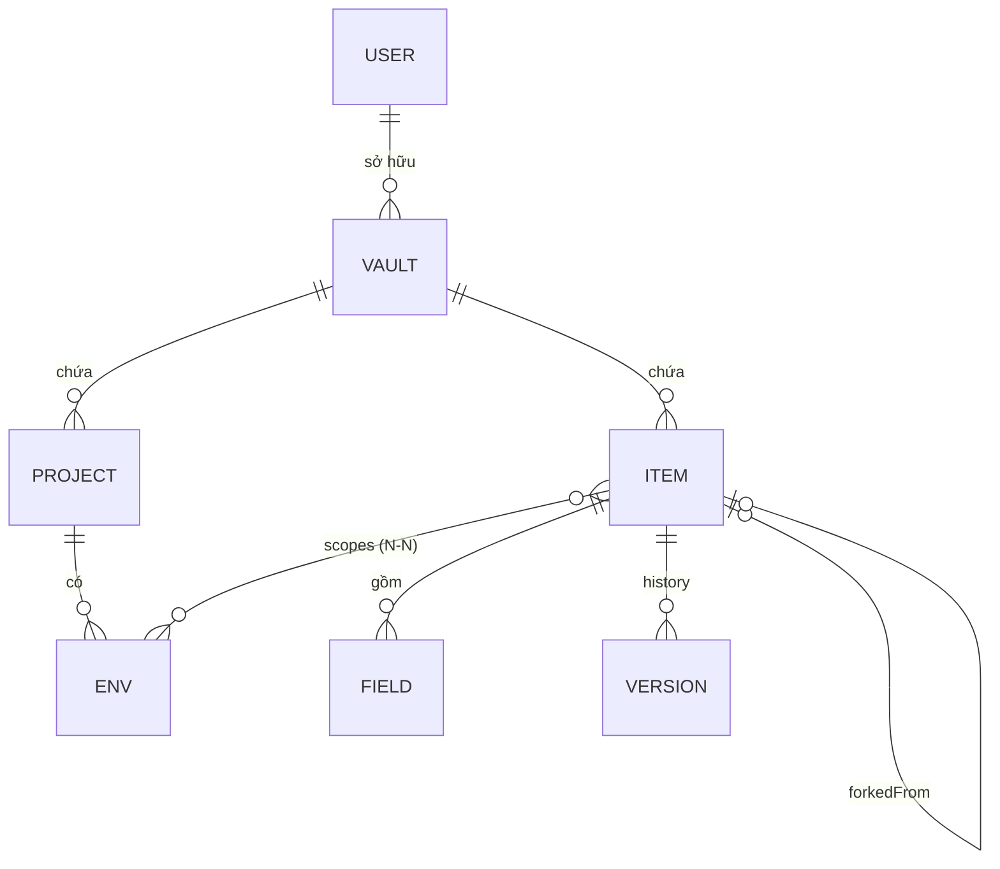

# 03 · Thiết kế dữ liệu

Dữ liệu nằm ở ba tầng:

1. **Vault (plaintext)**: JSON chỉ tồn tại trong bộ nhớ của client sau khi giải mã.
2. **Envelope (ciphertext)**: vault sau khi mã hoá, được lưu ở IndexedDB và trên server.
3. **D1 schema**: những gì server biết, gồm metadata, blob, session và audit.

Một người dùng có **một hoặc nhiều vault**. Mỗi vault là một tập `projects`, `envs`, `items` độc lập, có `vaultKey` riêng, được đồng bộ thành một blob riêng. Ở v2, giao diện chỉ tạo sẵn một vault mặc định; schema, API, lưu trữ và sync đều đã hỗ trợ nhiều vault từ đầu.

---

## 1. Vault v2 (plaintext, chỉ ở client)

### Mô hình khái niệm



- Một item có thể nằm trong nhiều env, **kể cả env thuộc các project khác nhau**, nhưng chỉ trong **cùng một vault**. Chuyển item sang vault khác là sao chép sang vault mới rồi xoá ở vault cũ.
- Item có `scopes = []` là item "chưa gán", vẫn hợp lệ và hiện trong mục *Chưa gán*.

### So với v1

| v1 (hiện tại, `legacy/envvault.html`) | v2 |
|---|---|
| Một vault duy nhất | Nhiều vault cho mỗi user, mỗi vault có khoá và blob riêng |
| `envs` lồng trong `project.envs[]` | Tách ra thành mảng phẳng `envs[]` với `projectId`, để gộp từng env độc lập |
| Xoá là xoá hẳn | Item vào **thùng rác** 30 ngày rồi mới xoá trắng; mọi thực thể dùng tombstone `deletedAt` |
| Project/env không có `updatedAt` | Mọi thực thể đều có `createdAt`, `updatedAt` và `rev` |
| Không có dấu thời gian theo field | Mỗi thuộc tính và mỗi field có đồng hồ riêng (`clock`) để **gộp theo field** |
| Khoá mã hoá dẫn xuất trực tiếp từ mật khẩu | Dùng `accountKey` và `vaultKey` ngẫu nhiên, được bọc lại (xem mục 2) |
| Không có thứ tự tuỳ chỉnh | Có `order` cho project và env |
| 6 loại item, 5 kiểu field | Thêm loại `db`, `server`, `vpn`; thêm kiểu field `otp` và thuộc tính `field.file` |

### Id

| Thực thể | Dạng | Ví dụ |
|---|---|---|
| Project, env, item, field, thiết bị | Tiền tố theo loại + 16 hex ngẫu nhiên | `p_8f3a…`, `e_19c2…`, `i_77ab…`, `f_01c4…`, `d_5e2b…` |
| Vault | **16 hex ngẫu nhiên, không tiền tố**. Đây là id duy nhất của vault đi qua API | `3f9c1a0b7d2e4c58` |
| User, session (phía server) | Tiền tố + 16 hex | `u_…`, `s_…` |

- Id lấy từ `crypto.getRandomValues`, không chứa thông tin gì, nên không cần băm hay HMAC trước khi gửi lên server.
- Id migrate từ v1 (hex trần) được **giữ nguyên**. Code chấp nhận cả dạng có và không có tiền tố, và không suy loại thực thể từ tiền tố.
- UI không hiện id thô. Màn debug hoặc audit log hiện dạng rút gọn (8 ký tự đầu).

### Đồng hồ (`clock`)

Mỗi giá trị có thể sửa độc lập đều có một đồng hồ `{ "at": <ms>, "dev": "<deviceId>" }`. Đồng hồ **không dùng để phát hiện thay đổi**: thay đổi được phát hiện bằng cách so giá trị với `base` khi gộp ba chiều. Đồng hồ chỉ dùng để phân xử khi cả hai bên cùng đổi **một** giá trị: `at` lớn hơn thắng, hoà thì so `dev`. Xem [05-sync.md](05-sync.md).

### Schema

```jsonc
{
  "v": 2,
  "vaultId": "3f9c1a0b7d2e4c58",
  "projects": [
    {
      "id": "p_8f3a…",
      "name": "Payment Gateway",
      "order": 0,
      "clock": { "name": { "at": 1761600000000, "dev": "d_5e2b…" }, "order": { … } },
      "createdAt": 1761600000000,
      "updatedAt": 1761600000000,
      "rev": 1,                   // tăng mỗi lần sửa
      "deletedAt": null           // tombstone
    }
  ],
  "envs": [
    {
      "id": "e_19c2…",
      "projectId": "p_8f3a…",
      "name": "uat",
      "order": 1,
      "color": null,              // tuỳ chọn, ví dụ "red" cho prod để dễ nhận ra
      "clock": { "name": { … }, "order": { … }, "color": { … } },
      "createdAt": 0, "updatedAt": 0, "rev": 1, "deletedAt": null
    }
  ],
  "items": [
    {
      "id": "i_77ab…",
      "type": "login",            // login | api_key | token | ssh | db | server | vpn | doc | note
      "title": "Partner X portal",
      "fields": [
        { "id": "f_01", "label": "Username", "kind": "text",   "v": "acme_uat",  "at": 0, "dev": "d_…", "deletedAt": null },
        { "id": "f_02", "label": "Password", "kind": "secret", "v": "••••",      "at": 0, "dev": "d_…", "deletedAt": null },
        { "id": "f_03", "label": "URL",      "kind": "url",    "v": "https://…", "at": 0, "dev": "d_…", "deletedAt": null },
        { "id": "f_04", "label": "One-time password", "kind": "otp", "v": "otpauth://totp/…", "at": 0, "dev": "d_…", "deletedAt": null }
      ],
      "fieldOrder": ["f_01", "f_02", "f_03", "f_04"],
      "notes": "Đối tác cấp, dùng chung UAT + Staging",
      "tags": ["partner-x"],
      "favorite": false,
      "expires": "2026-12-31",    // ISO date hoặc null, dùng để nhắc sắp hết hạn
      "scopes": ["e_19c2…", "e_5d10…"],
      "forkedFrom": null,         // id item gốc nếu là bản fork
      "clock": {                  // một đồng hồ cho mỗi thuộc tính đơn
        "type": { … }, "title": { … }, "notes": { … }, "favorite": { … },
        "expires": { … }, "forkedFrom": { … }, "fieldOrder": { … }, "deletedAt": { … }
      },
      "conflict": null,           // hoặc { "at": 0, "fields": ["f_02"], "attrs": ["notes"] } → badge ⚠
                                  // at: đồng hồ muộn nhất của các giá trị xung đột (09 § merge.js), không phải giờ hệ thống
                                  // attrs có thể có "deletedAt" / "purgedAt" khi xoá cạnh tranh với sửa
      "history": [                // tối đa HISTORY_MAX = 20, mới nhất ở đầu
        {
          "at": 1761500000000,
          "rev": 3,
          "dev": "d_…",
          "reason": "edit",       // edit | conflict | restore
          // "note": "deleted-elsewhere"  chỉ có trên bản conflict khi bên này chuyển item vào thùng rác
          //                              mà bên kia sửa nội dung (05 § Xoá, thùng rác và sửa); câu chữ do UI lo
          "title": "…", "type": "…", "fields": [], "notes": "…", "expires": null, "scopes": []
        }
      ],
      "createdAt": 0, "updatedAt": 0, "rev": 4,
      "deletedAt": null,          // đặt khi chuyển vào thùng rác
      "purgedAt": null            // đặt khi xoá trắng (hết hạn thùng rác hoặc xoá vĩnh viễn)
    }
  ]
}
```

- `field.label`, `field.kind`, `field.v` và `field.file` (nếu có) dùng chung đồng hồ `at/dev` của field: sửa bất kỳ phần nào của một field thì cả field được coi là đã đổi.
- Bản lịch sử `reason: "conflict"` do phép gộp ghi (05, 09 § `merge.js`): trạng thái **trước khi gộp** của một bên thua ít nhất một giá trị. `rev` là `rev` của bên đó, `at`/`dev` là đồng hồ muộn nhất của bên đó. Khoá `note` là tuỳ chọn và hiện chỉ có giá trị `"deleted-elsewhere"`. Dữ liệu cũ không có `note` vẫn hợp lệ, nên không cần migrate.
- `field.file` là tuỳ chọn, chỉ dùng cho `multi` và `secret-multi`: tên file gốc (ví dụ `"partnerx-uat.ovpn"`) khi nội dung được đọc từ file. Có `file` thì UI hiện tên file thay cho nội dung và có nút tải lại thành file đúng tên đó.
- `fieldOrder` là một thuộc tính đơn. Field có trong `fields` mà không có trong `fieldOrder` (do bên kia mới thêm) được nối vào cuối khi hiển thị.
- `scopes` và `tags` là **tập hợp**, không cần đồng hồ: khi gộp, phần thêm vào và phần bỏ ra so với `base` của cả hai bên đều được áp dụng.

### Kiểu field (`kind`)

| kind | Hiển thị | Copy | Ẩn mặc định |
|---|---|---|---|
| `text` | 1 dòng | ✓ | |
| `secret` | 1 dòng | ✓ | ✓ |
| `url` | link mở được | ✓ | |
| `multi` | nhiều dòng | ✓ | |
| `secret-multi` | nhiều dòng | ✓ | ✓ |
| `otp` | mã TOTP hiện tại + đếm ngược | ✓ (copy mã, không copy secret) | ✓ (secret không bao giờ hiện ở màn xem) |

- **File trong field nhiều dòng.** `multi` và `secret-multi` nhận nội dung từ file văn bản (nút *Chọn file…*, tối đa 64 KB). Vault không lưu file nhị phân; file lớn hơn hoặc nhị phân nằm ngoài phạm vi.
- **`otp`.** `v` là URI `otpauth://totp/…` (đọc từ QR) hoặc secret base32 nhập tay. Client tính mã theo RFC 6238 bằng WebCrypto HMAC, hỗ trợ tham số `digits`, `period`, `algorithm` (SHA1, SHA256, SHA512) trong URI; mặc định 6 số, 30 giây, SHA1. Chỉ hỗ trợ TOTP; URI `otpauth://hotp/…` bị từ chối khi nhập. QR được đọc bằng camera (`getUserMedia` + `BarcodeDetector`, có thư viện giải mã QR dự phòng cho Safari/Firefox) hoặc từ ảnh chụp màn hình.

### Mẫu field theo loại item

v1 có 6 loại đầu; `db`, `server`, `vpn` thêm ở v2. Loại chỉ quyết định icon và field mẫu lúc tạo; sau đó field vẫn thêm, xoá, đổi kiểu tự do.

| type | Field mặc định |
|---|---|
| `login` | Username (text), Password (secret), URL (url) |
| `api_key` | API key (secret), Secret (secret), Endpoint (url) |
| `token` | Token (secret-multi) |
| `ssh` | Private key (secret-multi), Public key (multi), Passphrase (secret) |
| `db` | Host (text), Port (text), Database (text), Username (text), Password (secret), Connection string (secret) |
| `server` | Host (text), Username (text), Password (secret), Admin URL (url) |
| `vpn` | Server (text), Username (text), Password (secret), Cấu hình (secret-multi, `file` mặc định `client.ovpn`) |
| `doc` | URL (url) |
| `note` | — (dùng `notes`) |

Field `otp` không nằm trong mẫu nào; người dùng thêm vào item bất kỳ (thường là `login`) qua *Thêm field*.

### Quy tắc toàn vẹn

- **Xoá env:** đặt `deletedAt` cho env đó. Các item vẫn **giữ** `envId` trong `scopes`, nhưng UI bỏ qua env đã xoá. Nhờ vậy, nếu thiết bị khác vẫn đang sửa item thì khi gộp không bị lỗi tham chiếu. Item không còn env sống nào thì hiện ở *Chưa gán*.
- **Xoá project:** đặt tombstone cho project và mọi env của nó. Item xử lý như khi xoá env.
- **Xoá item (vào thùng rác):** đặt `deletedAt`, **giữ nguyên** `fields`, `notes`, `history`. Item biến khỏi mọi danh sách, chỉ hiện trong *Thùng rác*. Khôi phục thì đặt `deletedAt = null`.
- **Xoá trắng (purge):** khi item nằm trong thùng rác quá `TRASH_DAYS = 30` ngày, hoặc người dùng bấm *Xoá vĩnh viễn*: đặt `purgedAt`, **xoá trắng `fields`, `notes`, `history`, `title`**. Tombstone còn lại (`id`, `deletedAt`, `purgedAt`) giữ mãi để thiết bị khác biết item đã bị xoá. Việc dọn thùng rác chạy ở client khi mở khoá.
- **Thay đổi đáng lưu lịch sử:** title, type, fields, notes, expires, scopes. Không tính `favorite`, `order` hay `fieldOrder`.
- `rev` tăng 1 mỗi lần lưu. `at` lấy theo giờ của thiết bị, chỉ dùng để phân xử khi cả hai bên cùng sửa một giá trị.

### Cài đặt riêng từng thiết bị (không nằm trong vault)

Lưu ở IndexedDB, không đồng bộ: thời gian tự khoá (desktop mặc định 10 phút không thao tác; mobile mặc định 60 giây sau khi chuyển nền; **chỉnh được trong cài đặt**), thời gian xoá clipboard, giao diện sáng/tối, vault/project/env đang chọn, có bật passkey hay không, file bản sao tự động (xem mục 3).

---

## 2. Khoá và envelope

### Cấu trúc khoá

```
master password
   │ PBKDF2-SHA256 (iter = 600 000, salt 16B)
   ▼
masterKey (32B)
   ├─ HKDF-SHA256(info="keymesh/enc")  ─▶ encKey  ─┐ bọc (AES-GCM)
   └─ HKDF-SHA256(info="keymesh/auth") ─▶ authKey  │
                                                     ▼
                     accountKey (32B ngẫu nhiên, sinh một lần khi tạo tài khoản)
                       ▲                     │ bọc từng vaultKey
passkey ─ PRF ─ HKDF ─┘ (chỉ lưu ở thiết bị)  ▼
                                     vaultKey_A, vaultKey_B, … (32B ngẫu nhiên, mỗi vault một khoá)
```

- Mở khoá **một lần** (master password hoặc passkey) là mở được `accountKey`, từ đó mở mọi `vaultKey`.
- Đổi master password chỉ bọc lại `accountKey`. Không phải mã hoá lại vault nào.
- Tách `vaultKey` theo vault giúp xoay khoá, xoá hoặc export một vault mà không đụng các vault khác. Sau này có thể cho một vault dùng mật khẩu riêng (bọc `vaultKey` bằng khoá dẫn xuất từ mật khẩu đó thay vì `accountKey`) mà không phải đổi schema: `wrappedVaultKey` đã có trường `by`.

### Tham số cố định

Chốt ở KM-001 (build-plan, originator xác nhận 2026-10-30). Khi đã có dữ liệu thật thì **không đổi được** nếu không chuyển đổi dữ liệu; bộ vector ở `testkit/vectors.js` fail ngay khi một giá trị dưới đây bị đổi.

| Tham số | Giá trị |
|---|---|
| Đầu vào PBKDF2 | Byte UTF-8 của master password, không chuẩn hoá Unicode |
| `masterKey` | 32B, đầu ra PBKDF2-HMAC-SHA256 với `kdf.salt` (16B) và `kdf.iter` (600 000 ≤ `iter` ≤ 6 000 000; ngoài khoảng này là `unsupported` trước khi chạy PBKDF2, vì `kdf` do server trả về lúc đăng nhập) |
| HKDF | HKDF-SHA256, **salt rỗng** (theo RFC 5869 §2.2 tương đương HashLen byte 0), đầu ra L = **32B** cho cả `encKey`, `authKey`, `prfKey` |
| `info` của HKDF | Byte UTF-8 của `keymesh/enc`, `keymesh/auth`, `keymesh/prf` |
| IKM của `prfKey` | Đúng 32B đầu ra PRF do WebAuthn trả về |
| AAD | Byte UTF-8 của chuỗi AAD ghi ở từng envelope dưới đây; `<vaultId>` là 16 hex chữ thường |
| AES-GCM | Khoá 256 bit, IV 12B, tag 16B nối sau ciphertext; `ct` = ciphertext ‖ tag |
| Khoá đã bọc | `ct` là AES-GCM của 32B khoá thô, nên luôn dài 48B |
| Base64 | Bảng chữ chuẩn (`+/`), có padding, không xuống dòng |
| Plaintext của vault và meta | `JSON.stringify` của đối tượng, mã hoá UTF-8; vault được gzip trước khi mã hoá |

Salt rỗng là đủ vì đầu vào HKDF đã là khoá đồng đều: `masterKey` đã có salt riêng cho từng user qua PBKDF2, và đầu ra PRF là 32B ngẫu nhiên của authenticator.

### Envelope cho vault

```jsonc
{
  "format": "keymesh",
  "v": 2,
  "alg": "AES-GCM-256",
  "iv": "<base64 12B>",
  "ct": "<base64>"         // AES-GCM(vaultKey, iv, gzip(JSON(vault)), aad = "keymesh/v2/vault/<vaultId>")
}
```

- Nén bằng `CompressionStream('gzip')` trước khi mã hoá để giảm kích thước.
- AAD gắn `vaultId`, nên blob của vault này không thể bị tráo sang vault khác mà vẫn giải mã được.
- Mỗi lần lưu dùng **IV ngẫu nhiên mới**.

### Envelope cho metadata vault

Tên và màu của vault cần có để hiện danh sách vault, nên được mã hoá riêng thành một envelope nhỏ, lưu cạnh blob:

```jsonc
{ "iv": "…", "ct": "…" }   // AES-GCM(vaultKey, JSON({ name, color, order }), aad = "keymesh/v2/vault-meta/<vaultId>")
```

Server không biết tên vault.

### Envelope cho khoá đã bọc

```jsonc
// accountKey đã bọc
{ "iv": "<base64 12B>", "ct": "<base64 48B>" }   // AES-GCM(encKey | prfKey, accountKey, aad = "keymesh/v2/account-key")

// vaultKey đã bọc
{ "by": "account", "iv": "…", "ct": "…" }       // AES-GCM(accountKey, vaultKey, aad = "keymesh/v2/vault-key/<vaultId>")
```

### File backup (export đã mã hoá)

Tự chứa đủ để mở lại mà không cần server. Có thể chứa một hoặc tất cả vault:

```jsonc
{
  "format": "keymesh-backup", "v": 2,
  "kdf": { "name": "PBKDF2-SHA256", "iter": 600000, "salt": "<b64>" },
  "wrappedAccountKey": { "iv": "…", "ct": "…" },
  "vaults": [
    { "id": "3f9c1a0b7d2e4c58", "wrappedVaultKey": { "by": "account", … }, "meta": { "iv": "…", "ct": "…" }, "vault": { …envelope… } }
  ],
  "exportedAt": 1761600000000
}
```

Cùng định dạng này được dùng cho nút *Tải backup* và cho **bản sao tự động ra file** (mục 3).

---

## 3. Lưu trữ cục bộ (IndexedDB `keymesh`, version 1)

| Object store | Key | Value |
|---|---|---|
| `meta` | `account` | `{ userId, username, kdf, wrappedAccountKey, deviceId }` |
| `meta` | `session` | `{ token, expiresAt }`. Token là bearer token để gọi API; nằm ở IndexedDB nên chỉ đọc được từ cùng origin |
| `meta` | `passkey` | `{ credentialId, prfSalt, wrappedAccountKey }` (bọc bằng prfKey) |
| `meta` | `settings` | cài đặt riêng của thiết bị |
| `meta` | `mirror` | `{ handle: FileSystemFileHandle, lastWrittenAt, lastError }`: file bản sao tự động (chỉ Chromium) |
| `vaults` | `<vaultId>` | `{ id, wrappedVaultKey, meta, metaVersion, current: { envelope, version, dirty, savedAt }, base: { envelope, version }, deletedAt }` |

- `current` là trạng thái cục bộ mới nhất, có thể chưa push. `base` là bản server ở lần đồng bộ thành công gần nhất. Mỗi vault có cặp `current`/`base` riêng.
- Không lưu plaintext, `accountKey` hay `vaultKey` dạng chưa bọc xuống đĩa trong bất kỳ trường hợp nào.

### Bản sao tự động ra file (chỉ ghi)

Trên trình duyệt hỗ trợ File System Access API (Chrome, Edge desktop), người dùng có thể chọn một file `.json` một lần. Sau đó:

- Sau mỗi lần lưu cục bộ (debounce 10 giây) hoặc sau mỗi lần sync thành công, client ghi đè file bằng một `keymesh-backup` chứa **tất cả vault**, qua `createWritable()` (ghi ra file tạm rồi thay thế).
- Client **không bao giờ đọc file này để đồng bộ**. Muốn khôi phục thì import thủ công (F-DATA-02).
- Quyền ghi thường mất sau khi khởi động lại trình duyệt. Khi đó thanh trạng thái hiện "Bản sao file: cần cấp lại quyền" và một nút để gọi `requestPermission()` (cần thao tác của người dùng). Mọi thứ khác vẫn chạy bình thường.
- Trình duyệt không hỗ trợ (Firefox, Safari, iOS) thì ẩn tuỳ chọn này, chỉ còn nút *Tải backup*.

---

## 4. D1 schema (server)

### Quy ước đặt tên

Theo cách đặt tên của ecm-hexa-be: tên bảng là **`<prefix>_<danh từ số ít>`**, snake_case.

| Prefix | Dùng cho | Bảng |
|---|---|---|
| `dt_` | Dữ liệu nghiệp vụ: user, vault, phiên đăng nhập, nhật ký | `dt_user`, `dt_vault`, `dt_vault_snapshot`, `dt_session`, `dt_audit_log` |
| `sys_` | Trạng thái vận hành của hệ thống, không phải dữ liệu người dùng | `sys_auth_attempt` |
| `bs_` | Danh mục, dữ liệu gốc | Chưa có |
| `cfg_` | Cấu hình lưu trong DB | Chưa có; cấu hình hiện là biến môi trường (`ALLOWED_ORIGINS`, `REGISTRATION_TOKEN`) |

- Index: `<bảng>_<cột>_idx`, ví dụ `dt_vault_user_id_idx`.
- Cột vẫn dùng `created_at`/`updated_at` (epoch ms, `INTEGER`).
- Prefix chỉ áp dụng cho bảng D1. Object store IndexedDB (`vaults`, `meta`…) và đường dẫn API (`/api/vaults`) giữ nguyên.

```sql
-- src/migrations/0001_init.sql

CREATE TABLE dt_user (
  id                  TEXT PRIMARY KEY,          -- 'u_' + 16 hex
  username            TEXT NOT NULL UNIQUE COLLATE NOCASE,
  kdf_name            TEXT NOT NULL DEFAULT 'PBKDF2-SHA256',
  kdf_iter            INTEGER NOT NULL,
  kdf_salt            TEXT NOT NULL,             -- base64
  auth_hash           TEXT NOT NULL,             -- base64(SHA-256(authKey))
  wrapped_account_key TEXT NOT NULL,             -- JSON {iv, ct}, bọc bằng encKey
  security_stamp      TEXT NOT NULL,             -- đổi khi đổi mật khẩu để vô hiệu hoá mọi session
  created_at          INTEGER NOT NULL,
  updated_at          INTEGER NOT NULL
);

CREATE TABLE dt_vault (
  id                  TEXT PRIMARY KEY,          -- 16 hex ngẫu nhiên, không tiền tố
  user_id             TEXT NOT NULL REFERENCES dt_user(id) ON DELETE CASCADE,
  wrapped_vault_key   TEXT NOT NULL,             -- JSON {by, iv, ct}, bọc bằng accountKey
  meta                TEXT NOT NULL,             -- JSON {iv, ct}: tên/màu/thứ tự đã mã hoá
  meta_version        INTEGER NOT NULL,          -- tăng mỗi lần đổi meta
  version             INTEGER NOT NULL,          -- tăng 1 mỗi lần PUT blob thành công
  blob                TEXT NOT NULL,             -- JSON envelope
  size                INTEGER NOT NULL,
  created_at          INTEGER NOT NULL,
  updated_at          INTEGER NOT NULL,
  updated_by_session  TEXT
);
CREATE INDEX dt_vault_user_id_idx ON dt_vault(user_id);

CREATE TABLE dt_vault_snapshot (                 -- giữ N bản gần nhất của mỗi vault để khôi phục khi lỡ tay
  vault_id            TEXT NOT NULL REFERENCES dt_vault(id) ON DELETE CASCADE,
  version             INTEGER NOT NULL,
  blob                TEXT NOT NULL,
  created_at          INTEGER NOT NULL,
  PRIMARY KEY (vault_id, version)
);

CREATE TABLE dt_session (
  id                  TEXT PRIMARY KEY,          -- 's_' + 16 hex, hiện trong danh sách thiết bị
  user_id             TEXT NOT NULL REFERENCES dt_user(id) ON DELETE CASCADE,
  token_hash          TEXT NOT NULL UNIQUE,      -- SHA-256(token); token gốc chỉ client giữ
  security_stamp      TEXT NOT NULL,             -- phải khớp dt_user.security_stamp
  device_name         TEXT,                      -- "Pixel 8 · Chrome"
  created_at          INTEGER NOT NULL,
  last_seen_at        INTEGER NOT NULL,
  expires_at          INTEGER NOT NULL           -- trượt: gia hạn 30 ngày mỗi lần dùng
);
CREATE INDEX dt_session_user_id_idx ON dt_session(user_id);

CREATE TABLE sys_auth_attempt (                  -- rate limit đăng nhập
  key                 TEXT PRIMARY KEY,          -- 'u:<username>' hoặc 'ip:<hash ip>'
  count               INTEGER NOT NULL,
  window_start        INTEGER NOT NULL,
  locked_until        INTEGER
);

CREATE TABLE dt_audit_log (
  id                  INTEGER PRIMARY KEY AUTOINCREMENT,
  user_id             TEXT,
  session_id          TEXT,
  vault_id            TEXT,
  at                  INTEGER NOT NULL,
  action              TEXT NOT NULL,             -- login | login_fail | logout | vault_create | vault_delete
                                                 -- | vault_put | vault_conflict | vault_rotate | snapshot_restore
                                                 -- | password_change | account_rotate | session_revoke
  meta                TEXT                       -- JSON nhỏ, KHÔNG chứa dữ liệu vault
);
CREATE INDEX dt_audit_log_user_id_at_idx ON dt_audit_log(user_id, at DESC);
```

### Ghi chú

- **Mọi truy vấn trên `dt_vault` và `dt_vault_snapshot` đều lọc theo `user_id` của session**, kể cả khi đã có `vault_id`, để một user không đọc hay ghi được vault của user khác dù đoán được id.
- **Giới hạn D1:** một dòng hoặc giá trị tối đa khoảng 2 MB. Vault cá nhân sau khi nén và mã hoá thường dưới 200 KB. Client cảnh báo khi blob vượt 1 MB; nếu thật sự cần thì tách bớt sang vault khác hoặc chia blob thành nhiều chunk.
- **Số snapshot:** giữ 30 bản gần nhất **cho mỗi vault**. Khi PUT, chép bản cũ sang `dt_vault_snapshot` rồi xoá bớt bản cũ trong cùng một `batch()`.
- **Những gì server biết:** username, số vault, kích thước và thời điểm sửa của từng vault, thiết bị, IP (dạng hash, dùng cho rate limit). Server **không** biết tên vault, tên project, env, item hay số lượng item.
- **Multi-user sau này:** bảng `dt_user` và `dt_vault` đã tách riêng, nên muốn chia sẻ chỉ cần thêm `dt_org`, `dt_member`, `dt_vault_member` hoặc `dt_env_key`. Một vault là đơn vị chia sẻ tự nhiên: bọc `vaultKey` bằng khoá công khai của từng thành viên. Xem [08-roadmap.md](08-roadmap.md).

---

## 5. Migrate v1 → v2

Có hai đường vào:

1. **Import file `envvault.json` v1** (`"format": "envvault"`, tên cũ của dự án): nhập mật khẩu cũ để giải mã.
2. **Import từ localStorage** (`envvault`), nếu chạy cùng origin với bản v1. Trường hợp này hiếm, vì v1 chạy dưới `file://` hoặc localhost.

Dữ liệu v1 được import vào **vault đang chọn** (mặc định là vault đầu tiên), hoặc vào một vault mới nếu người dùng chọn.

Các bước chuyển đổi trong `model.js`:

```text
clock0 = { at: now, dev: deviceId }
for project in v1.projects:
    for (i, env) in project.envs:  envs.push({...env, projectId: project.id, order: i, rev: 1, clock: all(clock0), …timestamps})
    project = {id, name, order, rev: 1, clock: all(clock0), …timestamps}
for item in v1.items:
    item.rev = history.length + 1; item.deletedAt = null; item.purgedAt = null
    item.tags = []; item.favorite = false; item.conflict = null
    item.clock = all(clock0); item.fieldOrder = fields.map(f => f.id)
    for field in item.fields: field.at = clock0.at; field.dev = clock0.dev; field.deletedAt = null
    history[*].rev, reason = 'edit'
giữ nguyên mọi id của v1 (hex trần)
mã hoá bằng vaultKey của vault đích → PUT lên server
```

Sau khi migrate, giữ nguyên file v1 và để người dùng tự xoá.
