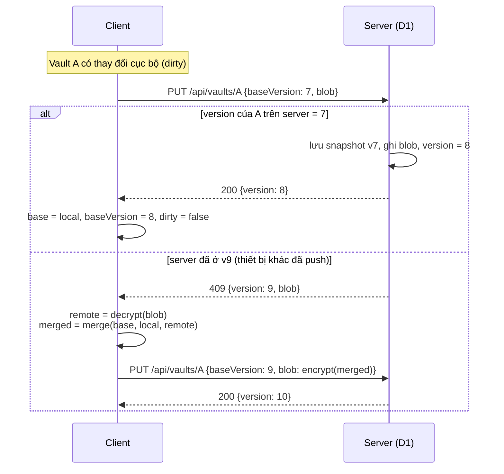

# 05 · Đồng bộ và gộp dữ liệu

## Mục tiêu

- Dùng được **offline-first**: mọi thao tác đọc/ghi diễn ra cục bộ trước, đồng bộ khi có mạng.
- **Không mất dữ liệu âm thầm** khi hai thiết bị cùng sửa.
- **Gộp theo field**: hai thiết bị sửa hai field (hoặc hai thuộc tính) khác nhau của cùng một item thì giữ được cả hai, không tính là xung đột.
- Server đơn giản: chỉ làm phép so sánh version (compare-and-swap) trên từng blob, **mỗi vault một blob**.

## Trạng thái ở client

Mỗi vault có bộ trạng thái riêng, lưu trong object store `vaults` (xem [03](03-data-model.md#3-lưu-trữ-cục-bộ-indexeddb-keymesh-version-1)):

| Biến | Lưu ở | Ý nghĩa |
|---|---|---|
| `local` | `vaults[id].current` | Vault hiện tại trên thiết bị, có thể có thay đổi chưa push |
| `base` | `vaults[id].base` | Bản server ở lần đồng bộ thành công gần nhất (cùng `baseVersion`) |
| `dirty` | `vaults[id].current.dirty` | Có thay đổi chưa push hay không |

Sync engine chạy **độc lập cho từng vault**: lỗi hay xung đột ở vault này không chặn vault khác.

## Giao thức



### Danh sách vault

`GET /api/vaults` trả về mọi vault của user kèm `version` và `metaVersion`, nhưng **không kèm blob**. Client dùng nó để:

- phát hiện vault mới được tạo ở thiết bị khác (tải `wrappedVaultKey`, `meta`, rồi pull blob);
- phát hiện vault đã bị xoá ở thiết bị khác (nếu không dirty thì xoá bản cục bộ; nếu đang dirty thì giữ lại, báo người dùng và cho chọn tạo lại hoặc bỏ);
- biết vault nào có `version` mới hơn `baseVersion` để chỉ pull những vault đó.

Đổi tên hoặc màu vault (`meta`) dùng `PATCH /api/vaults/:id` với `baseMetaVersion`. Nếu bị 409 thì bản có thời điểm sửa muộn hơn thắng, vì meta chỉ là tên và màu.

### Khi nào đồng bộ

| Sự kiện | Hành động |
|---|---|
| Mở khoá xong | `GET /api/vaults`, rồi pull các vault có version mới |
| Lưu thay đổi | Đặt `dirty` cho vault đó, rồi `push` sau 1,5 giây (debounce) |
| App quay lại foreground (`visibilitychange`) hoặc có mạng lại (`online`) | `GET /api/vaults`, pull vault có thay đổi, rồi `push` các vault đang dirty |
| Định kỳ khi đang mở | `GET /api/vaults` mỗi 60 giây (một request cho mọi vault; trả 304 nếu không vault nào đổi, theo `ETag`) |
| Người dùng bấm "Đồng bộ" | Như trên, cho mọi vault |

### Pull một vault

1. Gọi `GET /api/vaults/:id?since=baseVersion`. Nếu nhận 304 thì xong.
2. Nếu nhận 200 với `{version, blob}`:
   - Nếu không dirty: `local = base = remote`.
   - Nếu đang dirty: `local = merge(base, local, remote)`, `base = remote`, giữ dirty để push sau.

### Thử lại

Khi lỗi mạng hoặc 5xx, thử lại với backoff 2s, 5s, 15s, 60s. Thay đổi vẫn nằm an toàn trong IndexedDB. Thanh trạng thái hiển thị: `Đã đồng bộ`, `Đang đồng bộ…`, `Offline – N thay đổi chờ`, hoặc `Lỗi – thử lại` (gộp cho mọi vault, chạm vào để xem từng vault).

### Bản sao tự động ra file

Sau mỗi lần sync thành công (và sau mỗi lần lưu cục bộ, debounce 10 giây), nếu người dùng đã bật, client ghi đè file bản sao bằng một `keymesh-backup` chứa mọi vault. File này **chỉ được ghi, không bao giờ được đọc lại để sync**, nên không tham gia vào việc gộp. Xem [03](03-data-model.md#bản-sao-tự-động-ra-file-chỉ-ghi).

## Thuật toán gộp ba chiều theo field

`merge(base, local, remote)` là **hàm thuần**, áp dụng cho từng bảng `projects`, `envs`, `items` theo `id`, rồi **bên trong mỗi thực thể theo từng thuộc tính và từng field**. Nó trả về một vault mới; đánh dấu xung đột nằm ở `item.conflict`. Hợp đồng chi tiết (lỗi, thứ tự mảng, công thức `conflict.at`, khoá của bản lịch sử) ở [09-core-api.md](09-core-api.md) § `merge.js`. Không có `base` (vault chưa từng đồng bộ chung) thì coi `base` là vault rỗng.

### Bước 1: theo thực thể

```text
for id in union(ids(base), ids(local), ids(remote)):
    b, l, r = base[id], local[id], remote[id]

    if l == r:                → giữ l                       # giống nhau (so theo nội dung)
    elif r is missing:        → giữ l                       # mới tạo ở local
    elif l is missing:        → giữ r                       # mới tạo ở remote
    elif b is missing:        → mergeEntity({}, l, r)       # hai bên cùng tạo một id (hiếm: import cùng một file backup)
    else:                     → mergeEntity(b, l, r)
```

### Bước 2: theo thuộc tính (`mergeEntity`)

Mỗi giá trị được gộp bằng cùng một quy tắc ba chiều. "Đổi" nghĩa là **khác giá trị trong `base`** (so sâu), không dựa vào đồng hồ:

```text
merge3(b, l, r, clockL, clockR):
    if l == r:      → l
    elif l == b:    → r                      # chỉ remote đổi
    elif r == b:    → l                      # chỉ local đổi
    else:           → winner(clockL, clockR) # cả hai cùng đổi giá trị này → xung đột thật
                                             # at lớn hơn thắng, hoà thì so dev,
                                             # hoà cả hai thì so chính giá trị
```

**Đồng hồ hoà hoàn toàn** (cùng `at`, cùng `dev`, giá trị khác nhau) xảy ra được khi hai máy mang cùng `deviceId`, ví dụ khôi phục cùng một bản sao IndexedDB. Khi đó so dạng chuẩn của chính hai giá trị (JSON khoá đã sắp, so code unit), giá trị lớn hơn thắng. Nhờ vậy kết quả không phụ thuộc thứ tự `local`/`remote`.

| Phần của thực thể | Cách gộp |
|---|---|
| Thuộc tính đơn: `type`, `title`, `notes`, `expires`, `favorite`, `forkedFrom` (item); `name`, `order`, `color` (project/env) | `merge3` với `clock[attr]` |
| `fieldOrder` | Không sinh xung đột: chỉ một bên đổi thì lấy bên đó; cả hai cùng đổi thì giữ tập id ba chiều theo thứ tự của bên có `clock.fieldOrder` muộn hơn. Sau đó khớp với `fields` đã gộp (bỏ field đã xoá, thêm field còn sống còn thiếu). Lý do: mỗi lần thêm hay xoá field đều đổi `fieldOrder`, nên hai bên thêm hai field khác nhau sẽ luôn "cùng đổi" nó |
| `fields` | Gộp theo `field.id`. Field chỉ có ở một bên (mới thêm) thì giữ. Field có ở cả hai thì `merge3` trên cả field (`label`, `kind`, `v`, `file`, `deletedAt`) với đồng hồ `field.at/dev` |
| `scopes`, `tags` | Gộp tập hợp ba chiều: phần tử có trong kết quả nếu (có ở cả `l` và `r`) hoặc (có ở `l`, không có ở `b`) hoặc (có ở `r`, không có ở `b`). Nghĩa là thêm từ hai phía đều được giữ, bỏ từ một phía được áp dụng nếu phía kia không thêm lại |
| `history` | Gộp theo `(at, rev, dev)`, bỏ trùng (trùng khoá mà khác nội dung thì một quy tắc cố định chọn một bản), sắp mới nhất trước, cắt còn `HISTORY_MAX`. Bản `conflict` sinh ra **trong lần gộp này** luôn được giữ; khi phải cắt thì bỏ những bản cũ nhất trong số còn lại |
| `conflict` | Đánh dấu cũ gộp như tập hợp ba chiều so với `base`, theo từng id field và tên thuộc tính, rồi thêm xung đột mới của lần gộp này. Một bên đã bấm "Đã xử lý" mà bên kia không đổi thì đánh dấu cũ mất. Rỗng thì `null`. `conflict.at` lấy từ đồng hồ của các giá trị xung đột, không lấy giờ hệ thống |
| `deletedAt`, `purgedAt` | Quy tắc riêng, xem bảng xoá bên dưới |
| `rev`, `updatedAt` | Nội dung kết quả (mọi khoá trừ `rev`, `updatedAt`) bằng đúng một bên thì lấy nguyên `rev`/`updatedAt` của bên đó. Nếu không thì `rev = max(l.rev, r.rev) + 1` và `updatedAt = max(l.updatedAt, r.updatedAt, đồng hồ muộn nhất trong kết quả)`. Lý do: một số lần lưu tăng `updatedAt` mà không ghi đồng hồ nào (chỉ đổi `tags`/`scopes`, `deleteProject` chạm vào env, purge item đã trong thùng rác) |
| `createdAt` | Giá trị nhỏ hơn của hai bên |

### Xung đột thật

Chỉ xảy ra khi **cả hai bên cùng đổi một giá trị** (cùng một thuộc tính, hoặc cùng một field). Khi đó:

- Bản có đồng hồ muộn hơn thắng cho **riêng giá trị đó**. Các giá trị khác vẫn được gộp bình thường.
- **Mỗi bên thua ít nhất một giá trị** có trạng thái trước khi gộp của nó được đẩy vào `history` với `reason: "conflict"`, nên luôn khôi phục được. Một lần gộp có thể sinh hai bản cho cùng một item, ví dụ local thắng `notes` còn remote thắng `Password`. Khoá `(at, rev, dev)` của bản này chỉ suy ra từ chính bên đó, nên hai thiết bị gộp cùng ba bản sinh ra cùng một bản và lần gộp sau bỏ được bản trùng.
- Item được gắn `conflict = { at, fields: [id field xung đột], attrs: [tên thuộc tính xung đột] }`. UI hiện badge ⚠ và tô sáng đúng các field/thuộc tính đó, cho đến khi người dùng bấm "Đã xử lý".
- Với project/env: bản muộn hơn thắng, không lưu lịch sử và không gắn badge, vì chỉ có tên, thứ tự và màu.
- Hai bên cùng tạo một id (`base` không có id đó, ví dụ cùng import một file): gộp như với thực thể rỗng. Giá trị khác nhau là xung đột thật, giá trị giống nhau thì không, `tags`/`scopes` lấy hợp.

Ví dụ: laptop đổi `Password` (`f_02`), điện thoại sửa `notes` của cùng item khi offline. Kết quả có cả password mới lẫn notes mới, **không** có badge. Nếu cả hai cùng đổi `Password` thì bản sửa sau thắng, bản kia vào `history`, item có badge ⚠ trên field `Password`.

### Xoá, thùng rác và sửa

**"Sửa nội dung"** là đổi so với `base` bất kỳ thứ gì người dùng sửa được: `type`, `title`, `notes`, `expires`, `favorite`, `forkedFrom`, `fieldOrder`, một field (thêm, sửa hay xoá), `tags` hoặc `scopes` (so như tập hợp). Đổi `conflict` (bấm "Đã xử lý") không tính.

| Trường hợp | Kết quả |
|---|---|
| Một bên chuyển item vào thùng rác (`deletedAt`), bên kia **không** sửa nội dung | Item vào thùng rác |
| Một bên chuyển vào thùng rác, bên kia sửa nội dung | **Bên sửa thắng**: `deletedAt = null`, áp dụng các thay đổi nội dung. Bên xoá vào `history` với `reason: "conflict"` và `note: "deleted-elsewhere"` (UI hiện "đã bị xoá ở thiết bị khác"). `conflict.attrs` có `deletedAt`, item có badge ⚠ |
| Cả hai cùng chuyển vào thùng rác | Giữ `deletedAt` sớm hơn cùng `clock.deletedAt` của nó (để thời hạn 30 ngày tính từ lần xoá đầu) |
| Một bên khôi phục từ thùng rác, bên kia vẫn để trong thùng rác | `merge3` trên `deletedAt`: chỉ một bên đổi so với base, nên bên khôi phục thắng |
| Một bên khôi phục, bên kia khôi phục rồi xoá lại | Đồng hồ `clock.deletedAt` quyết định, `conflict.attrs` có `deletedAt`, bên thua vào `history`; nếu bên khôi phục đã sửa nội dung thì bên đó thắng như dòng 2 |
| Một bên xoá trắng (`purgedAt`), bên kia không sửa nội dung | Xoá trắng |
| Một bên xoá trắng, bên kia sửa nội dung **hoặc khôi phục** item khỏi thùng rác | Bên đó thắng: item sống lại với nội dung, lịch sử và `deletedAt` của bên đó, `purgedAt = null`, `conflict.attrs` có `purgedAt`, có badge ⚠. Bên xoá trắng không có bản lịch sử vì nội dung của nó đã bị xoá |
| Cả hai cùng xoá trắng | Một tombstone, giữ `deletedAt` và `purgedAt` sớm hơn |
| Xoá field (`field.deletedAt`) ở một bên, bên kia sửa field đó | `merge3` trên field: cả hai cùng đổi, nên đồng hồ muộn hơn thắng; bản thua vào `history` |

### Xoá project và env

Project/env không có đồng hồ cho `deletedAt`. Chỉ một bên đổi `deletedAt` so với `base` thì bên đó thắng; cả hai cùng xoá thì giữ `deletedAt` sớm hơn. Sửa thuộc tính ở một bên và xoá ở bên kia thì áp dụng cả hai: kết quả vừa đã xoá vừa có tên mới. Phép gộp **không tự tạo thêm lần xoá nào** và không gắn badge. Item được gán vào env mà bên kia đã xoá vẫn giữ id env đó trong `scopes` (theo quy tắc toàn vẹn ở 03). Env mới tạo trong project mà bên kia đã xoá vẫn được giữ, còn project vẫn ở trạng thái đã xoá. Cách hiển thị hai trường hợp này do KM-003 quyết định.

### Tính chất cần test

- `merge(b, x, x) == x` (idempotent).
- `merge(b, b, r) == r` và `merge(b, l, b) == l`.
- Đối xứng: `merge(b, l, r)` và `merge(b, r, l)` cho cùng nội dung (chỉ khác thứ tự trong `history` thì vẫn tính là bằng).
- Không id nào (thực thể hoặc field) xuất hiện trong input mà biến mất khỏi output.
- Sửa hai field khác nhau, hoặc hai thuộc tính khác nhau, của cùng một item ở hai bên: output chứa **cả hai** thay đổi và không có `conflict`.
- Thêm scope hoặc tag khác nhau ở hai bên: output chứa cả hai.
- Mọi nội dung "thua" đều tìm lại được trong `history` của output.
- Item chỉ vào thùng rác hoặc bị xoá trắng khi một bên xoá **và** bên kia không sửa nội dung.

## Server: so sánh version (compare-and-swap)

```sql
-- trong một batch()
INSERT INTO dt_vault_snapshot (vault_id, version, blob, created_at)
  SELECT id, version, blob, ?now FROM dt_vault WHERE id = ?vid AND user_id = ?uid AND version = ?base;
UPDATE dt_vault SET blob = ?blob, size = ?size, version = version + 1, updated_at = ?now, updated_by_session = ?sid
  WHERE id = ?vid AND user_id = ?uid AND version = ?base;
-- nếu số dòng UPDATE = 0 → trả 409 kèm bản hiện tại (hoặc 404 nếu vault không tồn tại)
DELETE FROM dt_vault_snapshot WHERE vault_id = ?vid AND version <= (SELECT version FROM dt_vault WHERE id = ?vid) - 30;
```

D1 xử lý tuần tự các lệnh ghi trên một database, nên `WHERE version = ?base` đủ đảm bảo không có lần ghi nào bị mất.

## Khôi phục snapshot

Người dùng chọn một vault, xem danh sách `dt_vault_snapshot` của vault đó (thời gian, thiết bị, kích thước) rồi chọn một bản. Client tải về và giải mã để xem trước. Khi bấm khôi phục, client **không ghi đè mù**: nó coi snapshot như một bản `remote` mới và PUT lên như một thay đổi bình thường, nên version vẫn tăng tiếp và bản hiện tại trở thành một snapshot khác.

Để lấy lại một item đã xoá, nên dùng **thùng rác** trước; snapshot là lưới an toàn cuối cùng cho cả vault.
