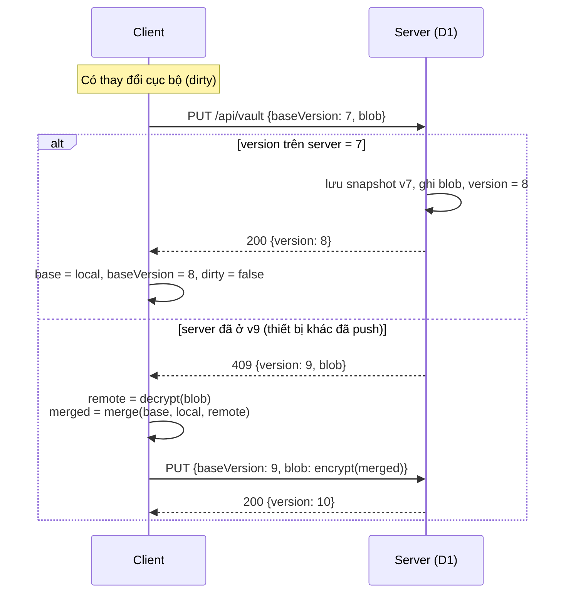

# 05 · Đồng bộ và gộp dữ liệu

## Mục tiêu

- Dùng được **offline-first**: mọi thao tác đọc/ghi diễn ra cục bộ trước, đồng bộ khi có mạng.
- **Không mất dữ liệu âm thầm** khi hai thiết bị cùng sửa.
- Server đơn giản: chỉ làm phép so sánh version (compare-and-swap) trên một blob.

## Trạng thái ở client

| Biến | Lưu ở | Ý nghĩa |
|---|---|---|
| `local` | `vault.current` | Vault hiện tại trên thiết bị, có thể có thay đổi chưa push |
| `base` | `vault.base` | Bản server ở lần đồng bộ thành công gần nhất (cùng `baseVersion`) |
| `dirty` | `vault.current.dirty` | Có thay đổi chưa push hay không |

## Giao thức



### Khi nào đồng bộ

| Sự kiện | Hành động |
|---|---|
| Mở khoá xong | `pull` |
| Lưu thay đổi | Đặt `dirty`, rồi `push` sau 1,5 giây (debounce) |
| App quay lại foreground (`visibilitychange`) hoặc có mạng lại (`online`) | `pull`, rồi `push` nếu đang dirty |
| Định kỳ khi đang mở | `pull` mỗi 60 giây (`GET /api/vault?since=<version>` trả 304 nếu không có gì mới) |
| Người dùng bấm "Đồng bộ" | `pull` và `push` |

### Pull

1. Gọi `GET /api/vault?since=baseVersion`. Nếu nhận 304 thì xong.
2. Nếu nhận 200 với `{version, blob}`:
   - Nếu không dirty: `local = base = remote`.
   - Nếu đang dirty: `local = merge(base, local, remote)`, `base = remote`, giữ dirty để push sau.

### Thử lại

Khi lỗi mạng hoặc 5xx, thử lại với backoff 2s, 5s, 15s, 60s. Thay đổi vẫn nằm an toàn trong IndexedDB. Thanh trạng thái hiển thị: `Đã đồng bộ`, `Đang đồng bộ…`, `Offline – N thay đổi chờ`, hoặc `Lỗi – thử lại`.

## Thuật toán gộp ba chiều

`merge(base, local, remote)` là **hàm thuần**, áp dụng cho từng bảng `projects`, `envs`, `items` theo `id`.

```text
for id in union(ids(base), ids(local), ids(remote)):
    b, l, r = base[id], local[id], remote[id]

    if l == r:                         → giữ l                      # giống nhau (so theo nội dung)
    elif r is missing:                 → giữ l                      # mới tạo ở local
    elif l is missing:                 → giữ r                      # mới tạo ở remote
    elif l == b:                       → lấy r                      # chỉ remote đổi
    elif r == b:                       → giữ l                      # chỉ local đổi
    else:                              → resolveConflict(b, l, r)   # cả hai đều đổi
```

So sánh "bằng nhau" dựa trên `rev` và `updatedAt`. Nếu `rev` bằng nhau nhưng nội dung khác thì xem như xung đột.

### resolveConflict

| Trường hợp | Kết quả |
|---|---|
| Một bên xoá (`deletedAt`), bên kia sửa nội dung | **Bên sửa thắng**, không xoá. Ghi `history` với `reason: "conflict"` và note "đã bị xoá ở thiết bị khác". Item có badge ⚠ |
| Cả hai cùng xoá | Giữ tombstone có `deletedAt` sớm hơn |
| Cả hai cùng sửa item | Bản có `updatedAt` lớn hơn thắng (hoà thì so `id` thiết bị). **Bản thua được đẩy vào `history`** với `reason: "conflict"`. Gắn cờ `conflict: true` để UI hiện badge ⚠ cho đến khi người dùng xem và bấm "Đã xử lý" |
| Cả hai sửa project/env | Bản có `updatedAt` lớn hơn thắng. Không lưu lịch sử vì chỉ có tên và thứ tự |
| `history` của hai bên | Gộp theo `(at, rev)`, bỏ trùng, cắt còn `HISTORY_MAX` |
| `scopes` | Tuân theo bên thắng; bản thua đã nằm trong `history` nên vẫn khôi phục được |

> Gộp ở cấp **item** chứ không phải cấp field: nếu cả hai bên cùng sửa hai field khác nhau của cùng một item thì vẫn tính là xung đột. Với dữ liệu cá nhân, trường hợp này hiếm, và lịch sử luôn giữ đủ để khôi phục. Có thể nâng lên gộp theo field sau.

### Tính chất cần test

- `merge(b, x, x) == x` (idempotent).
- `merge(b, b, r) == r` và `merge(b, l, b) == l`.
- Không id nào xuất hiện trong input mà biến mất khỏi output.
- Mọi nội dung "thua" đều tìm lại được trong `history` của output.
- Item chỉ bị xoá khi một bên xoá **và** bên kia không sửa.

## Server: so sánh version (compare-and-swap)

```sql
-- trong một batch()
INSERT INTO vault_snapshots (user_id, version, blob, created_at)
  SELECT user_id, version, blob, ?now FROM vaults WHERE user_id = ?uid AND version = ?base;
UPDATE vaults SET blob = ?blob, size = ?size, version = version + 1, updated_at = ?now, updated_by_session = ?sid
  WHERE user_id = ?uid AND version = ?base;
-- nếu số dòng UPDATE = 0 → trả 409 kèm bản hiện tại
DELETE FROM vault_snapshots WHERE user_id = ?uid AND version <= (SELECT version FROM vaults WHERE user_id = ?uid) - 30;
```

D1 xử lý tuần tự các lệnh ghi trên một database, nên `WHERE version = ?base` đủ đảm bảo không có lần ghi nào bị mất.

## Khôi phục snapshot

Người dùng xem danh sách `vault_snapshots` (thời gian, thiết bị, kích thước) rồi chọn một bản. Client tải về và giải mã để xem trước. Khi bấm khôi phục, client **không ghi đè mù**: nó coi snapshot như một bản `remote` mới và PUT lên như một thay đổi bình thường, nên version vẫn tăng tiếp và bản hiện tại trở thành một snapshot khác.
